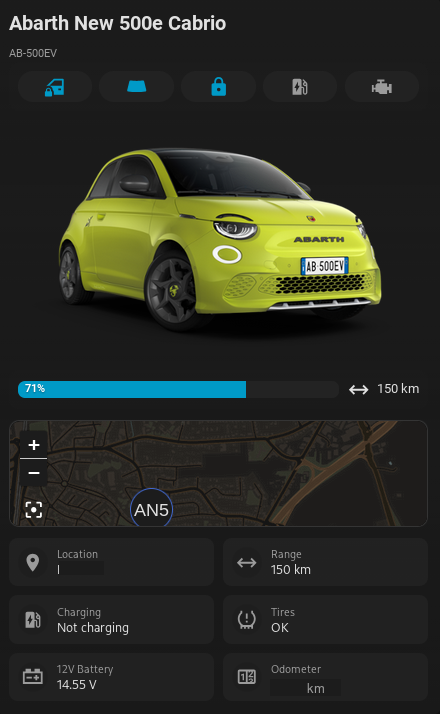

Connect your Uconnect-enabled vehicle to Home Assistant. This integration has been made from the reverse-engineered Stellantis vehicle-branded apps and websites.

## Car Brands

US, Canada, EU & Asia regions are supported. Try a different region if the originally selected region does not authenticate.

- Abarth: Works ✅
- Alfa Romeo: Works ✅
- Chrysler: Works ✅
- Dodge: Works ✅
- Fiat: Works ✅
- Jeep: Works ✅
- Lancia: Works ✅
- Maserati: Unknown ❔
- Ram: Works ✅

## Tested Vehicles

- See tested and working vehicles at the following discussion post: https://github.com/hass-uconnect/hass-uconnect/discussions/5
- If your vehicle works, feel free to upload the year, make and model to the discussion post.

## Prerequisites 📃

- Home Assistant
- [HACS](https://www.hacs.xyz) (Home Assistant Community Store) 
- A vehicle using Uconnect cellular services (see [SiriusXM Guardian](#siriusxm-guardian-vehicles) below if your vehicle uses SXM Guardian)
- Check the links below:
  - Alfa Romeo: https://connect.alfaromeo.com
  - Chrysler: https://connect.chrysler.com
  - Dodge: https://connect.dodge.com
  - Fiat: https://connect.fiat.com
  - Jeep: https://connect.jeep.com
  - Maserati: https://connect.maserati.com
  - Ram: https://connect.ramtrucks.com

## Features ✔️

- Imports statistics like battery level 🔋, tire pressure ‍💨, odometer ⏲, fuel type, vehicle health report, maintenance history, stolen vehicle status etc. into Home Assistant
- **Vehicle Image**: Displays your vehicle's image as an entity. The image is downloaded once and cached locally for fast access
- **Extrapolated Battery**: For EVs, provides a real-time battery estimate between API updates by tracking charging rate and idle drain, the drain being learned only from spells where the odometer confirms the car did not move. Automatically rejects stale data that would show impossible values (e.g., battery dropping while charging), and does not learn from a reading it rejected, and correctly handles state transitions (e.g., idle to charging, charging to driving). Polling alone returns a cached SOC that can go unchanged for hours, so a deep refresh is sent three minutes after charging starts, once the vehicle has settled on a time-to-full for the connected charger, and repeated at the configured interval until the session ends. The charging rate follows the vehicle's time-to-full until it can be measured from real SOC changes, and is preserved across sessions so extrapolation begins immediately on the next one
- **Charging Rate**: Shows the current charging speed in %/hour. Picks the time-to-full matching the charger the vehicle reports, including a domestic socket, and reports nothing rather than another charger's figure when the connected one publishes none. Computed over a 60-minute sliding window of SOC readings for stable output even with integer SOC values and irregular polling. Falls back to a time-to-full estimate until the first SOC gain is seen, since a window with no new reading means the API has not updated rather than that charging has stopped, and returns to that estimate once the last measurement is older than the window itself
- **Reset Battery Learning**: Button to reset the learned charging correction factor and idle drain rate back to defaults, and to drop the charging rate carried over from the last session. Useful when changing chargers or if learned values have drifted, the next session then starts from the vehicle's own time-to-full. The correction factor only applies while the rate comes from the vehicle's time-to-full, a rate measured from actual SOC changes is used as is, including one carried over from an earlier session
- Multiple Brands: Abarth, Alfa Romeo, Chrysler, Dodge, Fiat, Jeep, Lancia, Maserati & Ram
- Multiple Regions: America, Canada, Europe & Asia
- Supports multiple cars on the same account 🚙🚗🚕
- Location tracking 🌍
- Live vehicle status such as doors, windows, sunroof, trunk/liftgate, climate (on/off and cabin temperature) and ignition, for supported vehicles. States the vehicle reports as not available are shown as unknown
- Home Assistant zones (home 🏠, work 🏦 etc.) support
- Uses the same data source as the official app 📱
- Remote commands (unlock doors 🚪, switch HVAC 🧊 on , ...). **Use a service (action) to trigger commands**. Some commands may not work with all vehicles
- Available commands are (each action is only offered when one of your vehicles supports it):
  - `Refresh Location`: Updates the vehicle location
  - `Deep Refresh`: Refreshes EV battery level
  - `Deep Refresh (V2)`: Refreshes EV battery level using V2 API. Not needed normally: `Deep Refresh` uses V2 by itself for the vehicles that need it
  - `Lights/Horn`: Trigger vehicle horn and lights
  - `Lights`: Trigger vehicle lights
  - `Preconditioning On/Off`: Toggle vehicle preconditioning
  - `Trunk Lock/Unlock` / `Liftgate Lock/Unlock`: Lock/Unlock trunk/liftgate
  - `Doors Lock/Unlock`: Lock/Unlock vehicle doors
  - `Engine On/Off`: Remotely starts/stops the vehicle engine
  - `Cabin Ventilation`: Activates cabin ventilation
  - `Set Charge Schedule`: Sets the EV charge and climate schedules. Takes the list of schedules, e.g. the `schedules` attribute of the `Charge Schedule` sensor with your changes, or an object holding them as returned by the API
  - `Charge Now`: Initiates EV charging
  - `Charge Now (V4)`: Initiates EV charging using V4 API. Not needed normally: `Charge Now` uses V4 by itself for the vehicles that need it
  - `HVAC On/Off`: Toggles the HVAC. `HVAC On` optionally takes a target `temperature`, in the unit configured in Home Assistant, for vehicles supporting it
  - `Send Destination`: Sends a destination (`latitude`, `longitude` and an optional `name`) to the vehicle navigation system
  - `Comfort On/Off`: Another alternative to the above HVAC commands (depends on make/model)
  - `Update`: Asks the integration to update the data from the API immediately

## SiriusXM Guardian Vehicles

Some US-market vehicles use SiriusXM Guardian as their connected services provider
instead of the standard Uconnect cellular service. These vehicles were previously
reported as unsupported.

Analysis of the official Stellantis mobile apps (Ram, Chrysler, Wagoneer NAFTA) shows
that there are **no separate API endpoints** for SXM Guardian vehicles. All vehicles
use the same cloud API regardless of SDP type. The apps contain a legacy Mopar login
fallback that triggers a server-side account migration to Gigya when needed.

This suggests SXM Guardian vehicles should work once the account is migrated. However,
this has not been confirmed with a real SXM Guardian account yet.

If your SiriusXM Guardian vehicle does not appear in Home Assistant:

1. Install the official app for your brand (Jeep, Ram, Chrysler, Dodge, etc.)
2. Log in with your Mopar/SXM Guardian credentials
3. If the app prompts you to link or migrate your account, complete the process
4. Verify your vehicle is visible and functional in the official app
5. Use the same credentials with this integration

If your vehicle still does not appear after completing these steps, please open an
issue with your vehicle year, make, model, and whether it shows in the official app.

## What will NEVER work? ❌

- Things the Uconnect API does not support such as real time tracking or adjusting the audio volume.
- Some commands are vehicle specific and do not work across all makes and models.
- Some vehicles do not support live status for locks/windows/ignition. 

## How to install 🛠️

- Make sure you have [HACS](https://hacs.xyz/docs/use/#getting-started-with-hacs) already installed
- Add the [repository URL](https://github.com/hass-uconnect/hass-uconnect) to your HACS custom repositories as type `integration`
- Install the integration and restart Home Assistant
- Go to your integrations configuration page once started and add the Uconnect integration
- Fill e-mail, password and optionally PIN if you want to issue commands

If the login is rejected when the integration starts (e.g. after a password change), Home Assistant asks you to re-authenticate. Errors after a successful start are treated as temporary: they are logged and the last known data is kept.

After the integration is initialized - you might want to go into its options and enable the creation of command entities:


The options are:

- **Scan Interval (min)**: how often the integration polls the API, 5 minutes by default
- **Pin**: needed to issue remote commands, set it here if it was left empty during setup. A change takes effect straight away, and clearing the field falls back to the PIN given during setup
- **Deep Refresh While Charging (min, 0 disables, 15 minimum)**: how often to ask an EV to push fresh data while it is charging, 30 minutes by default. Polling alone returns a cached state of charge, so without this the extrapolated battery has nothing to correct itself against. Set it to 0 to only refresh once at the start of a charge. A change takes effect on the charge already under way. Requires a PIN and a vehicle that supports deep refresh. Three failures in a row end the refreshes for that session, since a vehicle that does not answer holds the request open for a minute each time
- **Add command entities (Button/Lock/Switch)**: create entities for the remote commands instead of using actions only

## Built-in Vehicle Card

The integration includes a custom Lovelace card (`custom:uconnect-vehicle-card`) that is automatically registered on setup. It shows:

- **Header**: Vehicle name and VIN (or custom license plate)
- **Indicators**: Doors, windows (including the rear ones and the sunroof), trunk or liftgate, charging status, ignition
- **SOC/Fuel bar**: Battery percentage with charging animation, range value
- **Vehicle image**: From the image entity (if available)
- **Mini map**: Live location from the device tracker
- **Quick info**: Location, range, charging state, tire pressure, 12V battery, odometer

To add the card: Edit a dashboard, add a card, search for "Uconnect Vehicle", and select your vehicle.

With dashboards in YAML mode, where resources can't be added by integrations, the card is loaded as an extra frontend module instead. Refresh the browser after setting up the integration for it to show up.



Card configuration options (all toggleable):
- `device_id` (required): Select your vehicle
- `license_plate`: Display a license plate instead of VIN
- `show_indicators`, `show_range`, `show_image`, `show_map`, `show_buttons`: Toggle sections

## Useful Resources

Cards:
  - [Ultra Card](https://github.com/WJDDesigns/Ultra-Card)
  - [Vehicle Status Card](https://github.com/ngocjohn/vehicle-status-card)

## Development

The tests use [pytest-homeassistant-custom-component](https://github.com/MatthewFlamm/pytest-homeassistant-custom-component), which needs the Python version of the current Home Assistant release (3.14):

```sh
python3.14 -m venv .venv && . .venv/bin/activate
pip install -r requirements_test.txt
ruff check . && ruff format --check . && pytest
```

The [py-uconnect](https://github.com/hass-uconnect/py-uconnect) library does the communication with the Uconnect cloud.
